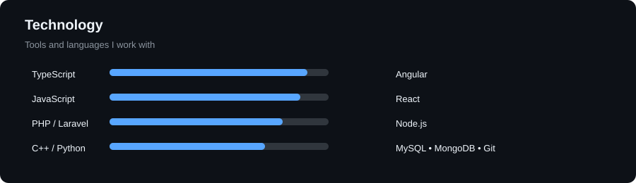

# Hi there 👋

I'm **Sadik Sikder**, a Software Engineer focused on **TypeScript, Angular, Laravel, and modern web development**.

I also enjoy **game development, problem solving, and exploring new technologies**.

  

  

  

---

### 🛠️ Tech Stack

  

---

### 🚀 What I Do

* 💻 Build web applications and APIs
* 🧩 Design scalable frontend & backend architecture
* 🧠 Solve algorithmic and engineering problems
* 🎮 Explore game development
* 🌱 Continuously learn and experiment with new technologies

---

### 📫 Connect

  
  

  

