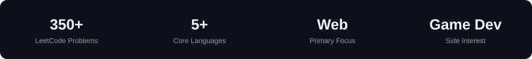

<h1 align="center">Hi, I'm Sadik Sikder 👋</h1>

  <b>Software Engineer</b> · TypeScript · Angular · Laravel · C++ 
  I build web apps for a living and low-level systems for fun.

  
  
  <!-- Add LinkedIn if you have it:
  
  -->

---

### 🔭 About me

- 💼 Building production web apps and APIs with **Angular, React, Laravel and Node.js**
- ⚙️ Writing a **web browser engine from scratch in C++20** in my spare time
- 🎮 Interested in game development, graphics and how things work under the hood
- 🧠 Enjoy algorithmic problem solving
- 📫 Reach me at **sadiksikder0@gmail.com**

---

### ⭐ Featured projects

#### [🌐 WTEngine](https://github.com/Sadik-Sikder/WTEngine)

A web browser engine for Windows, written from scratch in C++20. It has its own HTML parser, CSS engine (flexbox, grid, tables, positioning), layout engine, DOM bindings and OpenGL renderer, with JavaScript via quickjs-ng. It renders Wikipedia, BBC News and DuckDuckGo.

---

### 🛠️ Tech stack

**Languages** 

**Frontend** 

**Backend & data** 

**Tools** 

---

### 📊 Stats

  

  

  

